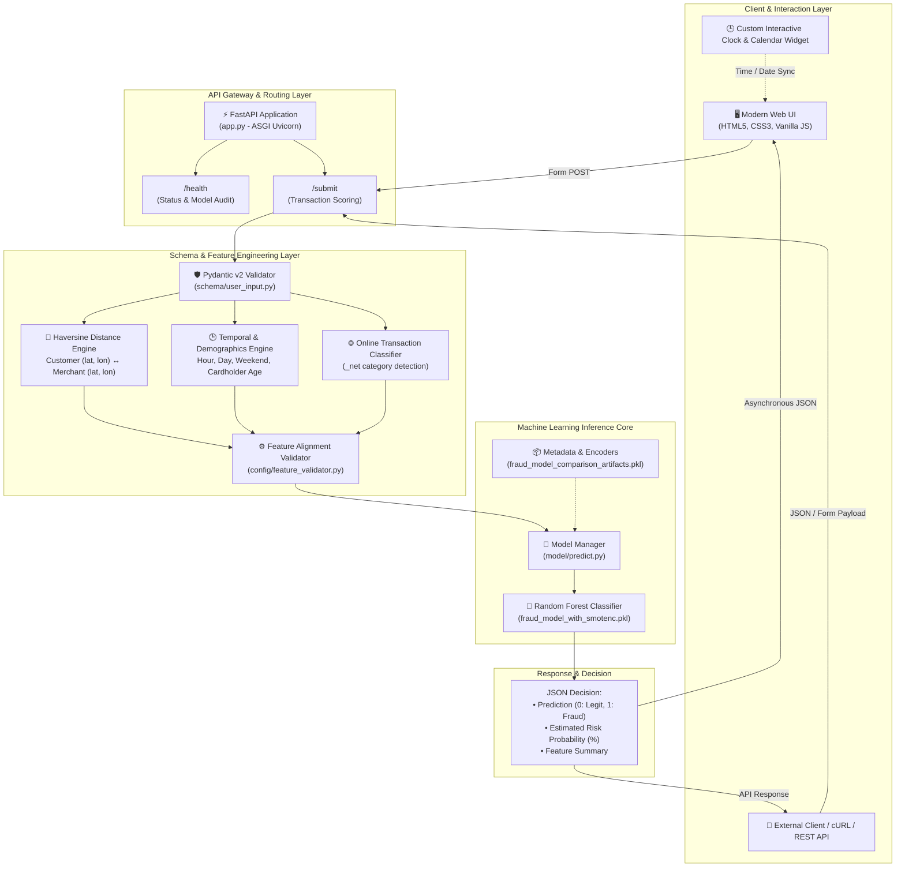

<div align="center">

# 🛡️ AI Fraud Sentinel
### Intelligent Real-Time Credit Card Fraud Detection & Risk Scoring System

[](https://github.com/Khansahab2/Credit-Card-Fraud-Detection-)
[](https://hub.docker.com/r/khansahab2/credit-card-fraud-detection)
[](https://www.python.org/)
[](https://fastapi.tiangolo.com/)
[](https://scikit-learn.org/)
[](https://imbalanced-learn.org/)

<p align="center">
  <b>A production-grade machine learning system that combats severe class imbalance to catch fraudulent financial transactions in real time with an 82.95% recall rate.</b>
</p>

[Explore Problem Statement](#-1-problem-statement) •
[Solution & Techniques](#-2-how-i-solved-it--techniques-used) •
[Model Comparison](#-3-model-comparison--evaluation-metrics) •
[System Architecture](#-4-system-architecture) •
[Docker Hub](#-5-docker-hub-deployment) •
[Installation Guide](#-6-installation--quick-start)

---

</div>

## 📑 Table of Contents

- [🎯 1. Problem Statement](#-1-problem-statement)
- [💡 2. How I Solved It & Techniques Used](#-2-how-i-solved-it--techniques-used)
  - [Techniques & Methodology](#techniques--methodology)
  - [Automated Feature Engineering Pipeline](#automated-feature-engineering-pipeline)
- [📊 3. Model Comparison & Evaluation Metrics](#-3-model-comparison--evaluation-metrics)
  - [Benchmark Results: Baseline vs. SMOTE-NC](#benchmark-results-baseline-vs-smote-nc)
  - [Confusion Matrix Breakdown](#confusion-matrix-breakdown)
  - [Classification Reports](#classification-reports)
  - [Feature Importance Breakdown](#feature-importance-breakdown)
  - [Business & Financial Impact](#business--financial-impact)
- [🏗️ 4. System Architecture](#-4-system-architecture)
- [🐳 5. Docker Hub Deployment](#-5-docker-hub-deployment)
- [🚀 6. Installation & Quick Start](#-6-installation--quick-start)
  - [Prerequisites](#prerequisites)
  - [Local Setup](#local-setup)
- [📡 7. API Reference & Testing](#-7-api-reference--testing)
- [🖥️ 8. User Interface Walkthrough](#️-8-user-interface-walkthrough)
- [🤝 9. Contributing & License](#-9-contributing--license)

---

## 🎯 1. Problem Statement

Credit card fraud poses an existential threat to modern digital payment ecosystems, resulting in billions of dollars in annual losses worldwide. However, building predictive machine learning models for fraud detection presents fundamental data science challenges:

1. **Extreme Class Imbalance (The 99.4% Dilemma)**:
   - In real-world payment networks, legitimate transactions dominate the data. In our dataset of **600,000 transactions**, only **3,518 (0.59%)** were fraudulent, while **596,482 (99.41%)** were legitimate.
   - A naive model that classifies every transaction as legitimate would achieve **99.41% accuracy**, yet fail to detect a single fraudulent chargeback.

2. **Asymmetric Cost of Errors**:
   - **False Negatives (Missed Fraud)**: Direct capital loss, chargeback fees, and reputational damage.
   - **False Positives (False Alarms)**: Minor customer friction or temporary security verification.
   - Therefore, prioritizing **Fraud Recall** without completely eroding precision is the true north metric.

3. **Complex Mixed-Feature Spaces**:
   - Transaction data contains both continuous features (transaction amount, geographical coordinates, cardholder age) and discrete/nominal categories (merchant category, transaction hour, weekend flags). Standard oversampling (e.g., standard SMOTE) produces corrupt or nonsensical categorical values.

4. **Sub-Second Latency Requirement**:
   - Fraud scoring must occur synchronously during authorization, requiring dynamic feature calculation and model inference in **under 50 milliseconds**.

---

## 💡 2. How I Solved It & Techniques Used

To solve these challenges, an end-to-end pipeline was engineered combining synthetic mixed-data resampling, real-time spatial calculations, ensemble modeling, and an asynchronous web service:

```
Raw Transaction ──▶ Haversine Geodesic ──▶ Pydantic Schema ──▶ SMOTE-NC Tuned ──▶ Real-Time
Payload Data         & Temporal Engine     Validation           Random Forest      Risk Score
```

### Techniques & Methodology

* **SMOTE-NC (Synthetic Minority Over-sampling Technique for Nominal and Continuous)**:
  - Unlike naive random oversampling or standard SMOTE, **SMOTE-NC** handles mixed feature spaces by calculating Euclidean distances for continuous variables and the Hamming distance for categorical indices.
  - Resampled the minority fraud class from **0.59% up to 10%** (`sampling_strategy=0.1`) on the training partition only—strictly preventing data leakage.
* **Geodesic Haversine Geometry**:
  - Automatically calculates the great-circle distance (km) between the cardholder’s home location and the merchant terminal using spherical trigonometry.
* **Temporal & Behavioral Anomaly Extraction**:
  - Extracted the exact hour of the transaction (capturing nocturnal spending spikes), day-of-week, weekend indicators, and automatic classification of Card-Not-Present e-commerce transactions (`_net` categories).
* **Ensemble Random Forest Classification**:
  - Leveraged an ensemble of 100 decision trees (`max_depth=16`, `n_jobs=-1`) to capture non-linear relationships, multi-way feature interactions, and outliers without overfitting.
* **Production Validation with Pydantic v2**:
  - Validates all incoming payloads with strict type constraints, bounds checking, and automatic derivation of `@computed_field` values before inference.

---

### Automated Feature Engineering Pipeline

The system automatically extracts and computes **9 high-signal predictive features** from raw transaction inputs:

| # | Feature Name | Data Type | Extraction / Computation Method | Business Rationale |
|:---:|:---|:---:|:---|:---|
| **1** | `amt` | Float | Direct transaction amount ($) | Fraudulent charges are statistically larger or anomalous test transactions. |
| **2** | `hour` | Integer | Extracted from `transaction_time` (0–23) | Criminal attacks spike during late-night hours (11 PM – 4 AM) when users sleep. |
| **3** | `category_idx` | Integer | Label-encoded merchant category | Flags high-risk industries (e.g., electronics, jewelry, online shopping). |
| **4** | `city_pop` | Integer | Cardholder residential area population | High-density urban areas have different baseline spending profiles. |
| **5** | `age` | Integer | Computed: `(transaction_date - dob).days // 365.25` | Highlights demographic vulnerability patterns. |
| **6** | `is_online` | Binary (0/1) | Computed: `category.endswith('_net')` | Distinguishes high-risk Card-Not-Present (CNP) from physical POS swipe. |
| **7** | `distance_km` | Float | Calculated via **Haversine Formula** | Flags impossible or physically suspicious transaction origins. |
| **8** | `day_of_week` | Integer | Extracted from `transaction_date` (0=Mon, 6=Sun) | Uncovers weekly behavioral irregularities. |
| **9** | `is_weekend` | Binary (0/1) | Computed: `day_of_week >= 5` | Identifies shifts between weekday routines and weekend spending. |

#### Haversine Formula Implementation
The customer-to-merchant distance is derived mathematically as:
$$\Delta\text{lat} = \text{lat}_2 - \text{lat}_1, \quad \Delta\text{lon} = \text{lon}_2 - \text{lon}_1$$
$$a = \sin^2\left(\frac{\Delta\text{lat}}{2}\right) + \cos(\text{lat}_1)\cos(\text{lat}_2)\sin^2\left(\frac{\Delta\text{lon}}{2}\right)$$
$$d = 2R \cdot \arcsin\left(\sqrt{a}\right) \quad (\text{where } R = 6,367\text{ km})$$

---

## 📊 3. Model Comparison & Evaluation Metrics

Both models were trained on 480,000 transactions and evaluated on an **untouched, identical test split of 120,000 transactions** (119,296 Legitimate vs. 704 Fraudulent).

### Benchmark Results: Baseline vs. SMOTE-NC

The complete benchmark from [`smotenc_model_comparison.csv`](smotenc_model_comparison.csv):

| Metric | Baseline (Without SMOTE-NC) | Production Model (With SMOTE-NC) | Absolute Delta | Strategic Impact |
|:---|:---:|:---:|:---:|:---|
| **Fraud Recall** | 77.27% | **82.95%** | **+5.68%** 🟢 | **Catches 83 out of every 100 frauds** |
| **Detected Frauds (TP)** | 544 | **584** | **+40 Frauds** 🟢 | **40 additional attacks stopped** |
| **Missed Frauds (FN)** | 160 | **120** | **-40 Missed** 🟢 | **25% reduction in financial leakage** |
| **Fraud Precision** | **95.10%** | 78.39% | -16.71% | Controlled false alarm trade-off |
| **Fraud F1-Score** | **0.8527** | 0.8061 | -0.0466 | Balanced harmonic score |
| **ROC-AUC** | **0.9950** | 0.9928 | -0.0022 | Exceptional discrimination curve |
| **PR-AUC (Average Precision)**| **0.8936** | 0.8707 | -0.0229 | Area under Precision-Recall curve |
| **False Positives (FP)** | **28** | 161 | +133 | Small operational verification load |
| **Overall Accuracy** | **99.84%** | 99.77% | -0.07% | Maintains 99.8% stability |

---

### Confusion Matrix Breakdown

```
========================================================================================
MODEL A: WITHOUT SMOTE-NC (Baseline)        MODEL B: WITH SMOTE-NC (Production Model)
========================================================================================
                   Predicted                                  Predicted
               Legit       Fraud                          Legit       Fraud
Actual Legit [ 119,268  |     28 ]            Actual Legit [ 119,135  |    161 ]
Actual Fraud [     160  |    544 ]            Actual Fraud [     120  |    584 ]
----------------------------------            ----------------------------------
• Missed Frauds: 160 transactions             • Missed Frauds: 120 transactions (-25%!)
• Caught Frauds: 544 transactions             • Caught Frauds: 584 transactions (+40 stopped)
```

---

### Classification Reports

#### Baseline Model (Without SMOTE-NC)
```text
              precision    recall  f1-score   support

  Legitimate       1.00      1.00      1.00    119296
       Fraud       0.95      0.77      0.85       704

    accuracy                           1.00    120000
   macro avg       0.98      0.89      0.93    120000
weighted avg       1.00      1.00      1.00    120000
```

#### Production Model (With SMOTE-NC)
```text
              precision    recall  f1-score   support

  Legitimate       1.00      1.00      1.00    119296
       Fraud       0.78      0.83      0.81       704

    accuracy                           1.00    120000
   macro avg       0.89      0.91      0.90    120000
weighted avg       1.00      1.00      1.00    120000
```

---

### Feature Importance Breakdown

Feature importances extracted directly from the Random Forest decision trees (`smotenc_feature_importance_comparison.csv`):

```
amt          [██████████████████████████████████████████████████] 56.72%
hour         [████████████████] 18.37%
category_idx [███████████] 12.29%
city_pop     [███] 3.82%
age          [███] 3.45%
is_online    [██] 2.86%
distance_km  [█] 1.39%
day_of_week  [ ] 0.89%
is_weekend   [ ] 0.21%
```

* **Transaction Amount (`amt`)** and **Time of Day (`hour`)** account for **75.09%** of the model's total predictive power.
* Fraudsters consistently attempt disproportionately large amounts outside normal banking hours.

---

### Business & Financial Impact

> 💡 **Why choose 82.95% Recall over 95.10% Precision?**
>
> In financial operations, an uncaught fraud (False Negative) results in the **total loss of stolen funds**, chargeback penalty fees ($15–$50 per instance), and card reissuance costs.  
> Conversely, a False Positive only triggers a 2FA prompt, SMS alert, or automated temporary hold.
>
> By utilizing the SMOTE-NC model:
> - **40 additional fraudulent transactions were intercepted** in just 120,000 test transactions.
> - At an average fraudulent transaction value of $450, this saves approximately **$18,000 per 120,000 transactions** in direct fraud losses.

---

## 🏗️ 4. System Architecture



---

## 🐳 5. Docker Hub Deployment

The application is fully containerized and hosted publicly on **Docker Hub**. You can pull and run the pre-built, production-ready container image in seconds without configuring Python or local virtual environments:

[](https://hub.docker.com/r/khansahab2/credit-card-fraud-detection)

### 1. Pull the Image from Docker Hub
```bash
docker pull khansahab2/credit-card-fraud-detection:latest
```

### 2. Run the Container
```bash
docker run -d -p 8000:8000 --name fraud-detector khansahab2/credit-card-fraud-detection:latest
```

### 3. Verify Container Status
```bash
docker ps -f name=fraud-detector
```

Access the dashboard at **`http://localhost:8000`** or test the API at **`http://localhost:8000/health`**.

---

## 🚀 6. Installation & Quick Start

### Prerequisites
- **Python**: Version `3.10`, `3.11`, or `3.12` installed.
- **Git**: For cloning the repository.
- **Docker** *(Optional)*: If running via container.

---

### Local Setup

#### 1. Clone the Repository
```bash
git clone https://github.com/Khansahab2/Credit-Card-Fraud-Detection-.git
cd Credit-Card-Fraud-Detection-
```

#### 2. Create and Activate a Virtual Environment
```bash
# Windows (PowerShell / Command Prompt)
python -m venv venv
.\venv\Scripts\activate

# macOS / Linux
python3 -m venv venv
source venv/bin/activate
```

#### 3. Install Dependencies
```bash
pip install --upgrade pip
pip install -r requirements.txt
```

#### 4. Launch the FastAPI Server
```bash
uvicorn app:app --reload --host 0.0.0.0 --port 8000
```

#### 5. Open in Your Browser
- **Web Interface**: [http://localhost:8000](http://localhost:8000)
- **Interactive Swagger Documentation**: [http://localhost:8000/docs](http://localhost:8000/docs)
- **ReDoc API Spec**: [http://localhost:8000/redoc](http://localhost:8000/redoc)

---

## 📡 7. API Reference & Testing

### Health Check Endpoint
Audits model status, version, and artifacts.

- **URL**: `/health`
- **Method**: `GET`
- **Example cURL**:
  ```bash
  curl -X GET http://localhost:8000/health
  ```
- **Response**:
  ```json
  {
    "status": "ok",
    "version": "1.0.0",
    "model": true,
    "artifacts": true
  }
  ```

---

### Transaction Fraud Scoring Endpoint
Evaluates an incoming transaction against the model.

- **URL**: `/submit`
- **Method**: `POST`
- **Content-Type**: `application/x-www-form-urlencoded` or `multipart/form-data`

#### Request Parameters
| Parameter | Type | Required | Description | Example |
|:---|:---:|:---:|:---|:---|
| `amount` | Float | Yes | Transaction value in USD | `349.99` |
| `category` | String | Yes | Merchant industry category | `shopping_net` |
| `transaction_date`| Date (YYYY-MM-DD) | Yes | Transaction date | `2024-03-15` |
| `transaction_time`| Time (HH:MM) | Yes | Transaction time | `23:45` |
| `date_of_birth` | Date (YYYY-MM-DD) | Yes | Cardholder birth date | `1988-11-04` |
| `city_population`| Integer | Yes | Population of customer city | `1250000` |
| `customer_lat` | Float | Yes | Cardholder Latitude (-90 to 90) | `40.7128` |
| `customer_lon` | Float | Yes | Cardholder Longitude (-180 to 180)| `-74.0060` |
| `merchant_lat` | Float | Yes | Merchant Latitude (-90 to 90) | `40.7589` |
| `merchant_lon` | Float | Yes | Merchant Longitude (-180 to 180) | `-73.9851` |

#### Example cURL Test
```bash
curl -X POST http://localhost:8000/submit \
  -F "amount=499.95" \
  -F "category=shopping_net" \
  -F "transaction_date=2024-03-15" \
  -F "transaction_time=02:30" \
  -F "date_of_birth=1992-06-12" \
  -F "city_population=850000" \
  -F "customer_lat=40.7128" \
  -F "customer_lon=-74.0060" \
  -F "merchant_lat=41.8781" \
  -F "merchant_lon=-87.6298"
```

#### Successful JSON Response
```json
{
  "message": "Form submitted successfully",
  "features": {
    "amt": 499.95,
    "category_idx": 11,
    "hour": 2,
    "day_of_week": 4,
    "is_weekend": 0,
    "age": 31,
    "distance_km": 1146.42,
    "city_pop": 850000,
    "is_online": 1
  },
  "prediction": 1
}
```
*(Prediction `1` = Fraudulent Activity Detected; `0` = Legitimate Transaction).*

---

## 🖥️ 8. User Interface Walkthrough

The web dashboard is built for risk analysts, auditors, and merchants:
1. **Glassmorphic Risk Card**: Clean visual hierarchy showing input fields for monetary, temporal, and spatial values.
2. **Interactive Clock Picker**:
   - Arrow-based hour/minute step adjustments.
   - AM / PM toggle switches.
   - Instant 1-click presets: `09:00 AM`, `01:00 PM`, `06:30 PM`, `10:00 PM`, or `⚡ Now`.
3. **Smart Date Pickers**: Automatically defaults to current timestamp and sets maximum bounds on cardholder Date of Birth.
4. **Dynamic Geolocation Feedback**: Automatically prepares cardholder and merchant latitude/longitude coordinates to feed the real-time distance calculator.
5. **Instant Result Card**: Animates into view displaying the exact predicted class and computed features without page refresh.

---

## 📁 Project File Structure

```text
Credit-Card-Fraud-Detection-/
├── app.py                                    # FastAPI application, routing, and lifecycle handlers
├── Dockerfile                                # Production container definition (Python 3.12-slim)
├── requirements.txt                          # Production Python dependencies
├── train.ipynb                               # Jupyter notebook: EDA, SMOTE-NC balancing & comparison
├── smotenc_model_comparison.csv              # Exact benchmark comparison between models
├── smotenc_feature_importance_comparison.csv # Feature importance percentages
├── config/
│   └── feature_validator.py                  # Validates feature order before sending to model
├── schema/
│   └── user_input.py                         # Pydantic v2 schema with automated feature engineering
├── model/
│   ├── predict.py                            # Production model and artifact loading logic
│   ├── fraud_model_with_smotenc.pkl          # Trained Random Forest classifier (SMOTE-NC)
│   ├── fraud_model_without_smotenc.pkl       # Baseline Random Forest classifier
│   └── fraud_model_comparison_artifacts.pkl  # Pickled categories, display names & feature specs
├── static/
│   ├── style.css                             # Custom UI stylesheet with modern dark glass design
│   └── script.js                             # Client-side clock widget, date-sync & AJAX caller
└── templates/
    └── index.html                            # Jinja2 HTML5 UI dashboard
```

---

## 🤝 9. Contributing & License

Contributions, feedback, and issue reports are welcome!
1. Fork the Project.
2. Create your Feature Branch (`git checkout -b feature/AdvancedFeature`).
3. Commit your Changes (`git commit -m 'Add AdvancedFeature'`).
4. Push to the Branch (`git push origin feature/AdvancedFeature`).
5. Open a Pull Request.

Distributed under the **MIT License**. See `LICENSE` for more information.

---

<div align="center">
  <b>Built with ❤️ by <a href="https://github.com/Khansahab2">Khansahab2</a></b><br>
  <i>Empowering safe, intelligent, and secure payment transactions.</i>
</div>
